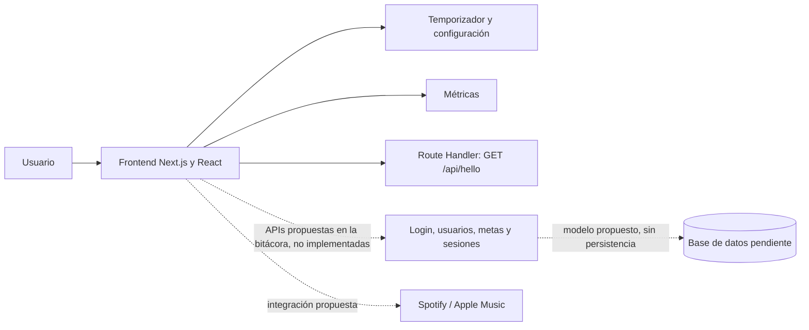

# Pomodoro Tracker

## Descripción general

Pomodoro Tracker es una aplicación web pensada para ayudar no solo a estudiantes, sino que a cualquier persona que desee organizar su tiempo, tanto de estudio como de trabajo, mediante la técnica Pomodoro: alternar periodos de concentración con pausas breves.

Usar el cronómetro del teléfono para estudiar termina resultando tedioso. Te obliga a revisar y controlar manualmente cada intervalo de tiempo, provocando distracciones. Sumando el echo de que sin un registro de actividad no se puede medir el progreso hacia una meta/objetivo diaria/o. Pomodoro Tracker busca simplificar ese proceso y fomentar un hábito constante/diario: el usuario pueda ser capaz de manejar su tiempo a conveniencia, organizar objetivos y consultar su progreso.

La aplicación permite utilizar un temporizador con ciclos de estudio y descanso, recibir avisos sonoros al cambiar de fase, configurar la duración de los intervalos y consultar una vista de métricas. El proyecto también contempla objetivos, registro de sesiones y vinculación con servicios de música como Spotify o Apple Music.

> **Estado actual:** el temporizador y su configuración funcionan en el navegador. La configuración se mantiene mientras la página está abierta; todavía no se persiste. La vista de métricas muestra datos de ejemplo y no está conectada a sesiones reales. Las cuentas de usuario, las metas, la persistencia, el historial de sesiones y la conexión a servicios de música aún no están implementados. Los puntos no implementados estarán señalados respectivamente.


**Capturas de pantalla:** PENDIENTE

<details>
<summary><strong>Instalación</strong></summary>

## Instalación

### Requisitos

- Node.js 26.12.1 y npm 11.20.0

### Ejecución local

1. Clonar el repositorio y entrar en la carpeta del proyecto:

	```bash
	git clone https://github.com/FrancoNavarreteN/TALLER4.git
	cd TALLER4
	```

2. Instalar dependencias:

	```bash
	npm install
	```

3. Iniciar el servidor de desarrollo:

	```bash
	npm run dev
	```

4. Abrir [http://localhost:3000](http://localhost:3000).

</details>

<details>
<summary><strong>Arquitectura del sistema</strong></summary>

## Arquitectura del sistema

La aplicación está desarrollada con Next.js App Router, React y JavaScript. La página principal mantiene la configuración y el estado del temporizador en React; estos valores se restablecen al recargar. Los avisos sonoros se generan en el navegador con Web Audio API. La página de metas y la vista de métricas comparten el estado administrado por `useMetas`; las metas y los registros manuales de horas se persisten en `localStorage` bajo la clave `pomodoro.metas.v1`. La API no participa en esos flujos: solo está implementado el endpoint de demostración `GET /api/hello`.



### Diseño registrado en la bitácora (pendiente de implementación)

Se propone un backend con servicios de autenticación, metas y sesiones. El modelo de datos conceptual considera:

- **Usuario:** `id` entero autoincremental (clave primaria), `email` único y `password`.
- **Goal (meta):** `id` entero autoincremental (clave primaria), `userId`, `name`, `goalHours`, `created`, `deadline` y `state`.
- **Session (sesión):** `id` entero autoincremental (clave primaria), `userId`, `goalId`, `roundCount`, `roundMinutes`, `breakMinutes` y `date`.

Aún no se define un motor de base de datos; por ello, el backend, la autenticación y la persistencia en servidor permanecen pendientes. El almacenamiento actualmente implementado para metas y registros es local al navegador. También se plantea como idea vincular la aplicación con Spotify o Apple Music para la música de ambiente; no existe una integración funcional.
</details>

<details>
<summary><strong>API</strong></summary>

## API

### `GET /api/hello`

Endpoint interno de demostración. No requiere autenticación ni cuerpo de solicitud.

**Parámetros de consulta**

| Parámetro | Tipo | Obligatorio | Descripción |
|---|---|---:|---|
| `name` | String | No | Nombre del saludo. Si se omite o está vacío, se utiliza `Invitado`. |

**Ejemplo**

```http
GET /api/hello?name=Ana
```

**Respuesta `200 OK`**

```json
{
  "status": "success",
  "message": "¡Hola, Ana! Tu endpoint en Next.js está funcionando correctamente.",
  "router": "App Router (Next.js)",
  "language": "JavaScript",
  "timestamp": "<fecha y hora ISO 8601>",
  "details": {
	 "location": "src/app/api/hello/route.js",
	 "method": "GET",
	 "environment": "<entorno de Next.js>"
  }
}
```

### Endpoints propuestos en la bitácora (no implementados)

Las rutas siguientes documentan el diseño registrado durante el proyecto. No están aún disponibles en la aplicación actual y sus respuestas son una propuesta, no una API desplegada.

#### `POST /api/login`

Iniciar sesión con las credenciales enviadas en el cuerpo:

```json
{
  "email": "ana@example.com",
  "password": "contraseña"
}
```

La bitácora propone una respuesta `200` con `{ "id": 1, "email": "ana@example.com" }` y errores `400` o `401` con `{ "error": "..." }`.

#### `POST /api/log`

La bitácora anota esta ruta como `POST`, con `email` y `password` en el cuerpo, respuesta `201` con `{ "id": 1, "email": "ana@example.com" }` y errores `400` o `409`. No especifica con más detalle el propósito de esta ruta.

#### `GET /api/goals` y `POST /api/goals`

- `GET` recibe `userId` como parámetro de consulta y propone devolver `goals`, una lista con `id`, `name`, `goalHours`, `created`, `deadline`, `state` y `doneHours`.
- `POST` recibe `name`, `goalHours` y `deadline`; propone devolver `id`, `created` y `state`.

#### `GET /api/sessions` y `POST /api/sessions`

- `GET` recibe `userId` como parámetro de consulta y propone devolver `sessions`, con `id`, `goalId`, `roundCount`, `roundMinutes`, `breakMinutes` y `date`.
- `POST` recibe `goalId`, `roundCount`, `roundMinutes` y `breakMinutes`; propone devolver `id` y `date`.

</details>

<details>
<summary><strong>Manual de usuario</strong></summary>

## Manual de usuario

TODO

</details>
