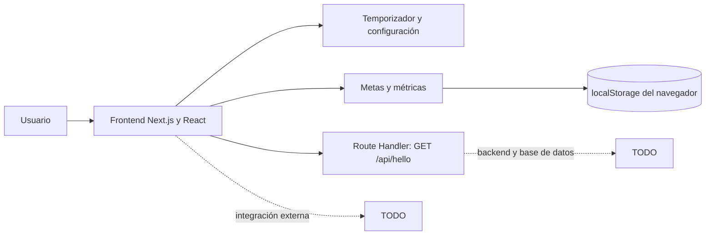

# Pomodoro Tracker

## Descripción general

Pomodoro Tracker es una aplicación web pensada para ayudar a estudiantes a organizar su tiempo de estudio mediante la técnica Pomodoro: alternar periodos de concentración con pausas breves. Por ejemplo, se puede estudiar durante 50 minutos y descansar durante 10.

Usar el cronómetro del teléfono obliga a revisar y controlar manualmente cada intervalo. Además, sin un registro de actividad es difícil saber cuánto se ha avanzado hacia una meta diaria. Pomodoro Tracker busca simplificar ese proceso y fomentar un hábito de estudio constante: el usuario puede configurar sus intervalos, organizar objetivos y consultar su progreso.

La aplicación permite utilizar un temporizador con ciclos de estudio y descanso, recibir avisos sonoros al cambiar de fase, configurar la duración de los intervalos y consultar una vista de métricas. El proyecto también contempla objetivos de estudio, registro de sesiones y vinculación con servicios de música como Spotify o Apple Music.

> **Estado actual:** en esta etapa SPRINT 2, el temporizador y su configuración funcionan en el navegador, la vista de métricas solo contiene datos de demostración. Las funciones de cuenta de usuario, objetivos persistentes, historial de sesiones y conexión a música están definidas como parte de la solución propuesta, pero sus endpoints o integraciones todavía no aparecen implementados en el código del repositorio. La API descrita más abajo documenta el contrato proporcionado para esas funciones; confirmar su disponibilidad en el servidor antes de depender de ellas.


**Capturas de pantalla:** TODO

<details>
<summary><strong>Instalación</strong></summary>

## Instalación

### Requisitos

- Node.js y npm. TODO — indicar versiones mínimas verificadas.

### Ejecución local

1. Clonar el repositorio y entrar en la carpeta del proyecto:

	```bash
	git clone https://github.com/FrancoNavarreteN/TALLER4.git
	cd TALLER4
	```

2. Instalar dependencias:

	```bash
	npm install
	```

3. Iniciar el servidor de desarrollo:

	```bash
	npm run dev
	```

4. Abrir [http://localhost:3000](http://localhost:3000).

Para crear y ejecutar una compilación de producción:

```bash
npm run build
npm run start
```

Para ejecutar ESLint:

```bash
npm run lint
```

</details>

<details>
<summary><strong>Arquitectura del sistema</strong></summary>

## Arquitectura del sistema

La aplicación está desarrollada con Next.js App Router, React y JavaScript. La interfaz y el temporizador funcionan en el navegador. Las metas y el registro de horas se guardan en `localStorage` bajo la clave `pomodoro.metas.v1`; las métricas se calculan a partir de esos datos. Los avisos sonoros se generan con Web Audio API.



Backend para cuentas, metas y sesiones: TODO

Base de datos: TODO

Servicios externos: TODO

</details>

<details>
<summary><strong>API</strong></summary>

## API

### `GET /api/hello`

Endpoint interno de demostración. No requiere autenticación ni cuerpo de solicitud.

**Parámetros de consulta**

| Parámetro | Tipo | Obligatorio | Descripción |
|---|---|---:|---|
| `name` | String | No | Nombre del saludo. Si se omite o está vacío, se utiliza `Invitado`. |

**Ejemplo**

```http
GET /api/hello?name=Ana
```

**Respuesta `200 OK`**

```json
{
  "status": "success",
  "message": "¡Hola, Ana! Tu endpoint en Next.js está funcionando correctamente.",
  "router": "App Router (Next.js)",
  "language": "JavaScript",
  "timestamp": "<fecha y hora ISO 8601>",
  "details": {
	 "location": "src/app/api/hello/route.js",
	 "method": "GET",
	 "environment": "<entorno de Next.js>"
  }
}
```

Otros endpoints: TODO

</details>

<details>
<summary><strong>Manual de usuario</strong></summary>

## Manual de usuario

TODO

</details>
